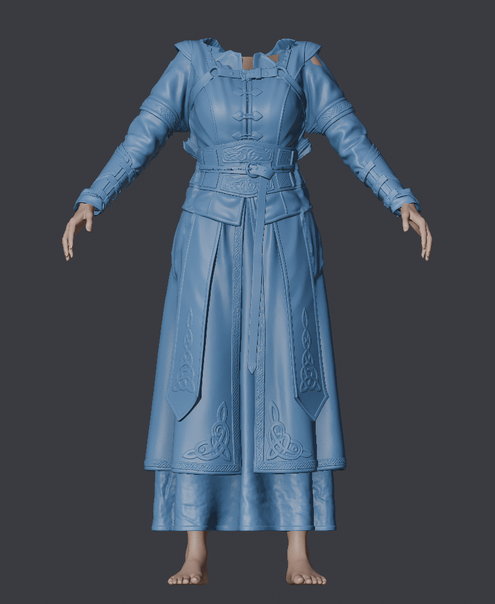
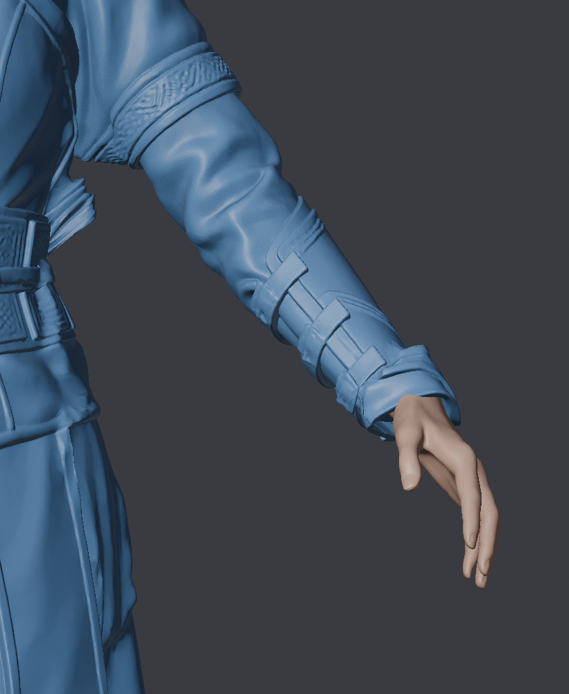

# Garment Fit for Blender

**衣服一键匹配人物 · One-click garment fitting for Blender**

[简体中文](#简体中文) · [English](#english)

---

## 简体中文

一键把衣服贴合到人物身上：自动蒙皮、手臂姿态校正、布料预处理、导出 UE 可用 FBX。

### 它解决什么问题

你把一件衣服（买的、扫描的、AI 生成的、别的骨架导出的）套到角色身上，通常会遇到：

- 在 UE 里衣服**完全不跟手臂动**；
- 手臂从袖子里穿出来；
- 胯部 / 胸口顶穿衣服；
- 衣服导进 UE 之后没有布料效果。

这个插件在 Blender 里一次把四件事做完，带进度条，一个按钮。

### 功能介绍

**1. 一键匹配（衣服 → 人物，默认）**

- **权重传递**：逐顶点找身体最近面 + 重心插值（不用那个经常传错的 `Data Transfer` 修改器）；
- **手臂姿态校正**：按骨骼（锁骨 / 上臂 / 小臂）对衣服的手臂簇做旋转 + 位移，通过衣服自身的**平滑权重场**驱动，所以不会把碎块网格撕开；
- **防穿模**：只把真正插进身体内部的顶点沿法线推出来，位移经过体素平滑；
- **绑定**：Armature 修改器 + 父级，每顶点最多 4 骨，世界变换保持不变。

**2. 反向模式（人物 → 衣服）**

把人物整体缩放到衣服的尺寸，旋转人物手臂骨骼塞进袖子，可选烘焙成新的静止姿势，再给衣服蒙皮。

**3. 尺寸匹配（两个按钮，统一缩放 + 可选对齐位置）**

面板顶部「尺寸匹配 (统一缩放, 比例不变)」两个按钮，只改大小、不改比例：

| 按钮 | 改谁 | 什么时候用 |
|---|---|---|
| **人物 → 衣服** | 人物（骨架 + 身体一起） | 衣服是对的，人物比例/单位不对 |
| **衣服 → 人物** | 衣服几何 | 人物是对的（UE 里的标准角色），衣服是从别处导进来的 |

- **缩放基准**：按高度 / 按包围盒对角线 / 按手臂(肩→腕)；
- **同时对齐位置**：勾上后两个物体的**包围盒中心**重合成同一个点（坐标位置一致）；关掉就只改尺寸、位置保持原样；
- **护手（袖口不盖手掌）**：缩放前先比"衣服袖口横向到达距离"和"人物手腕距离（肩关节 + 手臂链长，用静止姿势算，和当前 T/A-pose 无关）"，会盖住手掌就自动夹紧比例，面板上提示原始比例和实际比例；
- 人物的缩放是改 `armature.matrix_world`，导出时会被烘进骨骼和顶点，所以 UE 里是干净的 1:1；
- 对已蒙皮的衣服做「人物 → 衣服」时，会先解除绑定并保住世界变换（否则"两边一起缩放等于没匹配"）。

**4. 布料预处理（独立按钮 → 给 UE Chaos Cloth）**

Blender 的布料解算器**不能**导出到 UE。这一步是把网格准备好，让 UE 的解算器能用：

| 步骤 | 做什么 | 为什么 |
|---|---|---|
| 焊接 | 把几百个独立碎块焊成一个连续网格 | 布料解算要求连续拓扑 |
| 遮罩 | 顶点色 `ClothMask`（R = 可模拟，G = 固定）+ `CLOTH_SIM` / `CLOTH_PIN` 顶点组 | 领口 / 肩 / 腰带必须固定 |
| Sim 网格 | 复制一份 Decimate 到指定面数，绑到同一骨架 | UE 用低模解算、高模显示 |

实测（62 万顶点衣服）：碎块 595 → 1，顶点 622,715 → 593,924，Sim 网格 5,966 顶点 / 12,000 面，可模拟占比 75%。

**5. 导出**

- **只衣服 / 只人物 / 两个一起**，始终带骨架；
- 可选**带上 Sim 网格**；
- 把场景缩放（比如 0.01）烘进顶点和骨骼 → UE 里 1:1 米制、`scale = 1`。

**6. 安全保护**

- 自动识别骨骼命名（UE `upperarm_l`、Mixamo `LeftArm`、Maya `l_upperarm`、Unity `LeftForeArm`…）；
- 衣服与身体尺寸差太多时自动缩放；比例超过 5 倍直接报错，**不会毁模型**；
- 参数签名拦截：重复点击不会持续叠加变形；
- **还原衣服几何**按钮：一键回到处理前的形状。

### 安装

1. 下载 `garment_fit_addon.py`；
2. Blender → **编辑 ▸ 偏好设置 ▸ 插件 ▸ 安装…**（右上角箭头 → *从磁盘安装*）；
3. 选择 `garment_fit_addon.py`；
4. 在插件列表里勾选 **Garment Fit**；
5. 3D 视图按 **N** → 侧栏 **Garment Fit** 标签。

环境：Blender **4.2+**（在 5.1 验证），NumPy（自带）。无第三方依赖、不联网、无后台进程。

### 使用步骤

1. 选中人物身体 mesh → 点面板「身体」旁边的**吸管**（骨架自动填）；
2. 选中衣服 mesh → 点「衣服」旁边的吸管；
3. 保持 **匹配方向 = 衣服匹配人物**；
4. 点 **「一键匹配（姿态+蒙皮）」**，62 万顶点约 12~20 秒，状态栏有进度条；
5. 看正 / 侧 / 3-4 视角。袖子还松就调大「最大旋转角度」或「小臂强度」，再点 **「仅校正手臂姿态」**（不动权重）；
6. （可选）需要 UE 布料就点 **「布料优化」**；
7. 选导出范围 → 点 **「导出 FBX」**。

### 面板参数

**蒙皮**

| 参数 | 默认 | 说明 |
|---|---|---|
| 传递蒙皮权重 | 开 | 从身体重建全部顶点组 |
| 每顶点骨骼数 | 4 | UE 标准 |

**尺寸匹配**

| 参数 | 默认 | 说明 |
|---|---|---|
| 缩放基准 | 按高度 | 连体衣/全身服最稳；上衣/裤子改用「按包围盒对角线」；要袖口正好落在手腕选「按手臂(肩→腕)」 |
| 同时对齐位置 | 开 | 两个包围盒中心重合到同一点；关掉只改尺寸 |
| 护手（袖口不盖手掌） | 开 | 比较衣服袖口横向距离和人物手腕距离，超标自动夹紧，面板显示"应付比例 → 实际比例" |

**手臂姿态校正**

| 参数 | 默认 | 什么时候调 |
|---|---|---|
| 权重场平滑 | 2 | 有裂缝→调大；肩甲脱开→调小 |
| 最大旋转角度 | 12° | 袖子还松→18~25 |
| 最大位移 | 5 cm | 同上 |
| 总强度 | 1.0 | — |
| 肩 / 上臂 / 小臂强度 | 0.30 / 0.95 / 0.70 | 小臂露→调大小臂；绑带被拉坏→调小 |
| 迭代次数 | 2 | 没收敛→3 |
| 按碎块刚性 | 关 | 只在必须保住小片且能接受缝隙时开 |

**防穿模**：布料间隙 8 mm；最大推出 5 cm。

**布料预处理**

| 参数 | 默认 | 含义 |
|---|---|---|
| 焊接距离 | 0.5 mm | 焊接碎块缝隙 |
| 生成低模 Sim 网格 | 开 | |
| Sim 网格面数 | 12,000 | UE 解算预算 |
| 领口固定高度 | 8 cm | 顶部一圈固定 |
| 腰带高度比例 | 0.72 | 腰带一圈固定 |
| 肩部固定半径 | 12 cm | 肩关节周围固定 |
| 遮罩平滑 | 2 | 柔化遮罩边界 |

**导出**：只衣服 / 只人物 / 衣服+人物；可勾「带上 Sim 网格」。

### UE 5.x 导入

1. 导入 FBX：**Skeletal Mesh**，**Skeleton 选人物现有的那个**（不要新建）；
2. 关掉 `Use T0 As Ref Pose`、`Update Skeleton Reference Pose`；
3. 把衣服作为**人物 Skeletal Mesh 的第二个 Mesh 部件**，或用 **Leader Pose Component**；
   ❌ 不要用 `Attach to Component` / socket —— 那只是刚性跟随；
4. 布料：把 `..._Sim` 设为该衣服的 cloth / sim 网格，参考 `ClothMask` 顶点色刷 **Max Distance**（R=1 刷可模拟，G=1 刷 0）。
   参数起点：Mass 0.3~0.6 / Damping 0.5 / Bend 0.3 / Solver Frequency 60~120 / Substeps 2~4。

### 常见问题

| 现象 | 原因 / 解决 |
|---|---|
| 匹配后衣服消失 | 旧版本绑定时覆盖了世界矩阵。已修复：现在保留世界变换，尺寸异常会直接报错而不是毁模。 |
| 点了没变化 | 骨架可能只有 corrective 顶点组（`upperarm_bck_l` 之类）。v1.6 起已修复；自查：上臂区域平均位移 < 1cm 就是没跑。 |
| 领口被拽下来 | 锁骨旋转导致。已修复：锁骨只平移。 |
| 点两次越变形越糟 | 点「还原衣服几何」再跑一次；现在有参数签名拦截重复执行。 |
| UE 里布料炸开 | 没焊接（先跑「布料优化」）或面数太高。 |
| UE 里人物巨大/极小 | 导出时没烘缩放；本插件始终烘焙。 |

### 本项目文件

| 文件 | 说明 |
|---|---|
| `garment_fit_addon.py` | Blender 插件本体（单文件、无依赖） |
| `GARMENT_FIT_GUIDE.md` | 完整工程记录：根因、9 个失败方案、算法与参数、验证方法 |
| `UEPlugin/GarmentCloth/` | UE 5.8 编辑器插件：右键衣服网格 → 一键生成 Chaos Cloth 资产 |
| `preview_front.png` / `preview_arm.png` | 效果预览 |

### 许可

MIT，可商用。

---

## English

One-click fit a garment onto a character in Blender: auto-skinning, arm-pose correction, cloth pre-processing and UE-ready FBX export.

### What it solves

Drop a garment (bought, scanned, AI-generated, exported from another rig) onto a character and you usually get:

- the clothes **don't follow the arms** in Unreal;
- arms poke out through the sleeves;
- hips / chest clip through the fabric;
- no cloth simulation after importing to UE.

This add-on fixes all four inside Blender, with a progress bar and one button.

### Features

**1. One-click match (garment → character, default)**

- **Weight transfer** — per-vertex nearest surface + barycentric interpolation from the body (not the unreliable `Data Transfer` modifier).
- **Arm-pose correction** — rotates / translates the garment's arm clusters per bone (clavicle / upper arm / lower arm) through its own **smooth weight field**, so a fragmented mesh never tears apart.
- **Penetration fix** — only vertices actually inside the body are pushed out, through a voxel-smoothed field.
- **Bind** — armature modifier + parent, max 4 influences per vertex, world transform preserved.

**2. Reverse mode (character → garment)**

Scales the character to the garment's height, rotates the character's arm bones into the sleeves, optionally bakes it as the new rest pose, then skins the garment.

**3. Size match (two buttons, uniform scale + optional position alignment)**

Two buttons at the top of the panel, *Size match (uniform scale, proportions kept)*:

| Button | Who changes | When |
|---|---|---|
| **Character → Garment** | character (armature + body) | the garment is right, the character's scale/units are not |
| **Garment → Character** | garment geometry | the character is right (your UE hero), the garment came from somewhere else |

- **Scale basis**: height / bounding-box diagonal / arm (shoulder→wrist);
- **Align positions** (on by default): makes the two bounding-box centers coincide, so both objects share one coordinate frame; turn it off to change size only;
- **Cuff guard (sleeves must not swallow the palms)**: compares the garment's lateral sleeve reach with the character's wrist reach (shoulder joint + arm chain length, measured in rest pose, so mismatched T/A poses don't fool it) and clamps the factor if needed, reporting both the requested and applied factor;
- The character is scaled through `armature.matrix_world`, which the FBX export bakes into bones and vertices — clean 1:1 in UE;
- For an already-skinned garment, *Character → Garment* detaches the garment and keeps its world transform first (otherwise scaling both sides is a no-op match).

**4. Cloth pre-processing (separate button → for UE Chaos Cloth)**

Blender's cloth solver **cannot** be exported to UE. This step prepares the mesh so UE's solver can use it:

| Step | What | Why |
|---|---|---|
| Weld | merge hundreds of loose shells into one continuous surface | solvers need continuous topology |
| Mask | vertex color `ClothMask` (R = simulate, G = pin) + `CLOTH_SIM` / `CLOTH_PIN` groups | collar / shoulders / belt must stay pinned |
| Sim mesh | decimate a copy to N triangles, bind it to the same skeleton | UE simulates low-poly, displays high-poly |

Measured on a 622k-vertex garment: shells 595 → 1, verts 622,715 → 593,924, sim mesh 5,966 verts / 12,000 tris, 75% simulatable.

**5. Export**

- **Garment only / Character only / Both**, always with the skeleton;
- optional **Sim mesh**;
- bakes the scene scale (e.g. 0.01) into vertices and bones → clean 1:1 metric FBX, `scale = 1` in UE.

**6. Safety rails**

- Auto bone-name detection (UE `upperarm_l`, Mixamo `LeftArm`, Maya `l_upperarm`, Unity `LeftForeArm`…);
- auto scale when sizes differ wildly; hard error above 5× instead of destroying the mesh;
- parameter signature guard — clicking twice never compounds the deformation;
- **Restore geometry** button — one click back to the pre-processed shape.

### Installation

1. Download `garment_fit_addon.py`;
2. Blender → **Edit ▸ Preferences ▸ Add-ons ▸ Install…** (top-right arrow → *Install from Disk*);
3. Pick `garment_fit_addon.py`;
4. Enable **Garment Fit** in the add-on list;
5. In the 3D viewport press **N** → sidebar tab **Garment Fit**.

Requirements: Blender **4.2+** (tested on 5.1), NumPy (bundled). No dependencies, no network, no background processes.

### Usage

1. Select the character body mesh → click the **eyedropper** next to *Body* (the armature is detected automatically);
2. Select the garment mesh → click the eyedropper next to *Garment*;
3. Keep **Match direction = Garment → Character**;
4. Click **One-click match (pose + skin)** — ~12–20 s for a 600k-vertex garment, with a progress bar;
5. Review front / side / 3-4 views. If the sleeves are still loose, raise **Max rotation** or **Forearm strength**, then press **Correct arm pose only** (does not touch weights);
6. *(Optional)* Click **Cloth prep** if you want cloth simulation in UE;
7. Choose the export scope and click **Export FBX**.

### Panel reference

**Skin**

| Parameter | Default | Notes |
|---|---|---|
| Transfer weights | on | rebuilds all vertex groups from the body |
| Bones per vertex | 4 | UE standard |

**Size match**

| Parameter | Default | Notes |
|---|---|---|
| Scale basis | Height | safest for full-body outfits; use *Bounding-box diagonal* for tops/pants; *Arm (shoulder→wrist)* puts the cuffs exactly at the wrists |
| Align positions | on | makes both bounding-box centers coincide; off = resize only |
| Cuff guard | on | compares the garment's sleeve reach with the character's wrist reach and clamps the factor, showing requested vs applied |

**Arm-pose correction**

| Parameter | Default | Tune when |
|---|---|---|
| Weight-field smoothing | 2 | cracks → up; shoulder plates detach → down |
| Max rotation | 12° | sleeves still loose → 18–25 |
| Max translation | 5 cm | same |
| Total strength | 1.0 | — |
| Shoulder / Upper arm / Forearm strength | 0.30 / 0.95 / 0.70 | forearm exposed → up; bracer straps stretched → down |
| Iterations | 2 | not converged → 3 |
| Rigid per chunk | off | only if you must keep small plates and accept seams |

**Penetration fix**: cloth gap 8 mm; max push 5 cm.

**Cloth prep**

| Parameter | Default | Meaning |
|---|---|---|
| Weld distance | 0.5 mm | merges coincident shell seams |
| Generate sim mesh | on | |
| Sim triangles | 12,000 | UE solver budget |
| Collar pin height | 8 cm | top band pinned |
| Belt height ratio | 0.72 | waist ring pinned |
| Shoulder pin radius | 12 cm | around the shoulder joint |
| Mask smoothing | 2 | softens mask borders |

**Export**: garment only / character only / both; optional sim mesh.

### Importing into UE 5.x

1. Import the FBX as **Skeletal Mesh**, choose the **existing character Skeleton** (do not create a new one);
2. Disable `Use T0 As Ref Pose` and `Update Skeleton Reference Pose`;
3. Add the garment as a **second Mesh component of the character's Skeletal Mesh**, or use **Leader Pose Component**;
   ❌ Do **not** attach it to a socket — that is rigid following, the sleeves still won't move;
4. Cloth: set the `..._Sim` mesh as the cloth/sim mesh, then paint **Max Distance** using the `ClothMask` vertex color as a guide (R = 1 → simulate, G = 1 → pin).
   Starting values: Mass 0.3–0.6, Damping 0.5, Bend 0.3, Solver Frequency 60–120, Substeps 2–4.

### Troubleshooting

| Symptom | Cause / fix |
|---|---|
| Garment disappears after matching | old build overwrote the world matrix on bind. Fixed — transform is preserved and a scale sanity check aborts instead of destroying the mesh. |
| Nothing changed after clicking | the body rig may use only *corrective* groups (`upperarm_bck_l`, …). Fixed since v1.6; check per-region displacement: < 1 cm means it didn't run. |
| Collar pulled down | clavicle rotation dragged it. Fixed: clavicle translation only. |
| Clicking twice keeps deforming | press **Restore geometry**, then run once. The parameter signature now blocks a repeat run. |
| Cloth explodes in UE | mesh not welded (run **Cloth prep**) or triangle budget too high. |
| Character huge/tiny in UE | export without baking scale — this add-on always bakes. |

### Repository contents

| File | Purpose |
|---|---|
| `garment_fit_addon.py` | the Blender add-on (single file, no dependencies) |
| `GARMENT_FIT_GUIDE.md` | full engineering write-up: root causes, 9 failed approaches, exact algorithms and parameters |
| `UEPlugin/GarmentCloth/` | UE 5.8 editor plugin: right-click a garment mesh → one-click Chaos Cloth Asset |
| `preview_front.png` / `preview_arm.png` | result previews |

### License

MIT. Free for commercial use.
